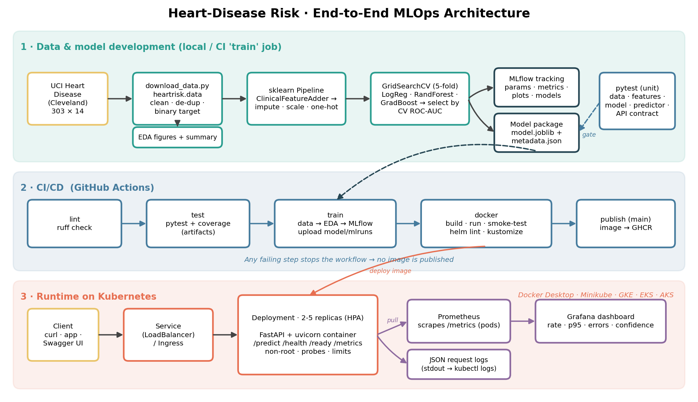

# Heart-Disease Risk Prediction - End-to-End MLOps

Reproducible ML pipeline for the UCI Heart Disease (Cleveland) dataset: data -> EDA -> tuned models ->
MLflow tracking -> packaged pipeline -> tested FastAPI service -> Docker -> Kubernetes ->
Prometheus/Grafana monitoring, all automated with GitHub Actions.



> Educational prototype (303 patients, single clinic). Not a medical device.

## Quick start (macOS / Linux)
```bash
bash scripts/bootstrap_mac.sh        # once: Homebrew tools (see docs/SETUP.md for the full list)
make setup                           # .venv + pinned requirements
make data                            # download UCI data -> data/raw, clean -> data/processed
make eda                             # figures -> reports/figures
make train                           # tune 3 models, log to MLflow, save models/model.joblib
make test lint                       # pytest + ruff
make docker-build docker-run docker-test
make k8s-deploy                      # Docker Desktop / Minikube (+ Prometheus + Grafana)
```
One-shot verification of everything except Kubernetes: `bash scripts/run_pipeline.sh`.
All commands: `make help`. Full environment list: **[docs/SETUP.md](docs/SETUP.md)**.

## Call the API
```bash
curl -s -X POST http://localhost:8000/predict -H 'Content-Type: application/json' -d @scripts/sample_request.json
```
Response shape (values illustrative):
```json
{"prediction": 1, "label": "heart_disease", "confidence": 0.91, "probability_disease": 0.91,
 "risk_level": "high", "model_version": "1.0.0-3fa9c2d1", "request_id": "..."}
```
Swagger UI: `/docs` - batch scoring: `POST /predict/batch` - health: `/health`, `/ready` - `/metrics` for Prometheus.
Kubernetes (Docker Desktop) is reachable at `http://localhost`; otherwise `kubectl -n heart-risk port-forward svc/heart-risk-api 8080:80`.

## Assignment-to-artifact map
| # | Task (marks) | Where to look |
|---|---|---|
| 1 | Data & EDA (5) | `scripts/download_data.py`, `src/heartrisk/data.py`, `eda.py`, `notebooks/01_eda.ipynb`, `data/`, `reports/figures/` |
| 2 | Features & models (8) | `features.py` (ClinicalFeatureAdder + ColumnTransformer), `modeling.py` (LogReg / RF / GradBoost, grids, CV), `notebooks/02_training.ipynb` |
| 3 | Experiment tracking (5) | `tracking.py`, `train.py` -> `mlruns/` (`make mlflow-ui`) - parent run + child run per model with params, metrics, plots, tuning CSV, model |
| 4 | Packaging & reproducibility (7) | `models/model.joblib` + `metadata.json`, MLflow models, pinned `requirements*.txt`, whole preprocessing inside the Pipeline, seeded + tested determinism |
| 5 | CI/CD & tests (8) | `tests/` (see below), `.github/workflows/ci.yml` (lint -> test -> train -> docker -> publish, artifacts every run) |
| 6 | Containerisation (5) | `Dockerfile`, `src/heartrisk/api/`, `scripts/smoke_test.sh` |
| 7 | Deployment (7) | `k8s/` (kustomize), `helm/heart-risk-api/`, `scripts/k8s_deploy.sh` |
| 8 | Monitoring & logging (3) | JSON request logs, `api/metrics.py`, `k8s/monitoring/` + `monitoring/` (Prometheus, Grafana dashboard), `docker-compose.yml` |
| 9 | Documentation (2) | this README, `docs/`, `scripts/build_report.py` -> `reports/Heart_Disease_MLOps_Report.{docx,md,pdf}` |

## Design decisions worth knowing
* **No leakage:** imputation, scaling and encoding live in the sklearn Pipeline, fitted per CV fold; the 6 missing cells stay `NaN` in the cleaned CSV.
* **Selection on CV, not on test:** tuning by stratified 5-fold ROC-AUC, winner re-scored on a different shuffle; the hold-out set is only for the final report.
* **One artefact for train and serve:** the API loads the same Pipeline object, so there is no train/serve skew.
* **Production hygiene:** strict input validation (HTTP 422), fail-fast startup if the model is missing, non-root container, probes, resource limits, read-only root FS, request-id correlated JSON logs, bounded metric-label cardinality.
* **Light serving image:** `requirements-serve.txt` excludes MLflow/matplotlib.

## Tests
`pytest` runs 50+ tests on a synthetic Cleveland-shaped dataset (no network): cleaning rules, transformer maths and NaN handling,
leak-free preprocessing, determinism, metric validity, model-selection rule, saved-model round trip, MLflow logging,
API contract (valid/invalid payloads, metrics, 404 label cardinality, fail-fast startup). The workflow fails on any lint or test error.

## Repository layout
```
src/heartrisk/        data.py features.py modeling.py train.py eda.py plots.py tracking.py predictor.py api/
tests/                pytest suite          notebooks/   01_eda 02_training 03_inference
scripts/              download_data, smoke_test, generate_traffic, k8s_deploy, run_pipeline, build_report, ...
k8s/                  deployment service ingress hpa pdb + monitoring/ (Prometheus, Grafana, dashboard JSON)
helm/heart-risk-api/  equivalent Helm chart   monitoring/  Prometheus + Grafana config for docker compose
.github/workflows/    ci.yml                  docs/        SETUP, architecture, VIDEO_SCRIPT
data/ models/ reports/ screenshots/   (generated / evidence)
```

## Deliverables checklist
- [ ] `make data` run and `data/raw`, `data/processed` committed
- [ ] `make train` run (models/ committed so `docker build` works on a fresh clone)
- [ ] Pushed to GitHub, Actions green (+ one deliberate red run for the screenshot)
- [ ] 15 screenshots in `screenshots/` (list: `screenshots/README.md`)
- [ ] `make report` -> add your name, ID, repo URL, video link; export PDF
- [ ] Video recorded (`docs/VIDEO_SCRIPT.md`)
- [ ] Personalise (see below)

## Make it yours
This is a complete reference implementation; your submission should reflect your own choices and understanding.
Things to change and be ready to explain: the engineered features in `features.py`, grids and candidate models in
`modeling.py`, the random seed, risk bands, dashboard panels, resource limits, extra tests, and the wording of the report.
Run everything yourself so every metric, figure and screenshot comes from *your* run.
